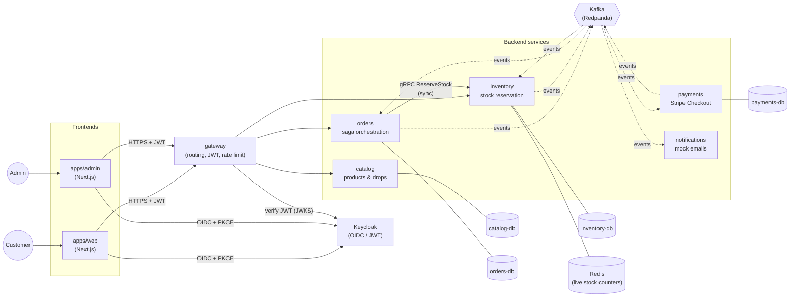
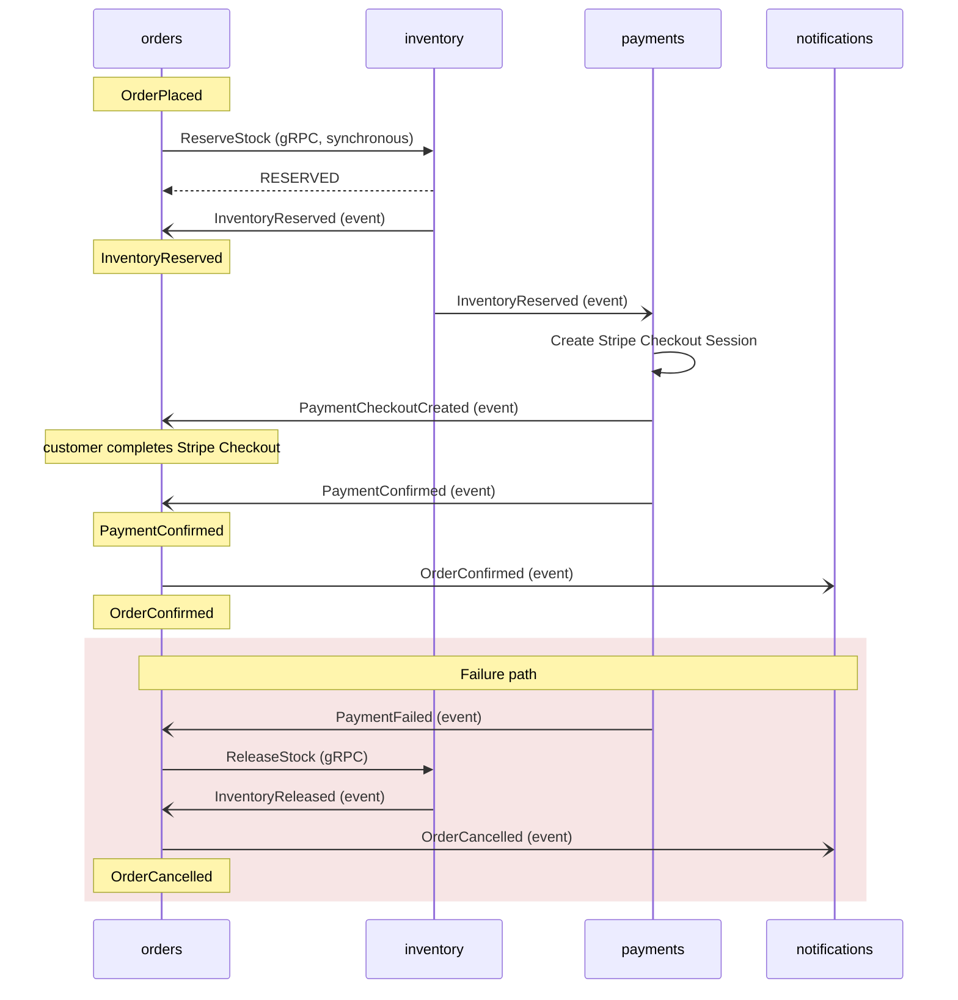

# Dropwire

Dropwire is a flash-sale / limited-drop e-commerce platform, built as a portfolio project to
demonstrate production-grade distributed systems design, not just CRUD over a database.

A "drop" releases a small, fixed batch of a product at a specific time. When it opens, a crowd of
buyers hits the same few rows at once. The engineering problem that drives every decision in this
repo is:

1. **Never oversell stock**, no matter how many buyers race for the last unit at the same instant.
2. **Recover cleanly** when a downstream dependency (payment provider, a Kafka consumer, a
   database) fails partway through an order.

Everything else — the service boundaries, the saga, the outbox pattern, the load test — exists in
service of those two guarantees.

## How it actually proves the claim

The inventory service is load-tested with real concurrent traffic, not a code read-through:

```
300 concurrent gRPC ReserveStock calls, against 50 units of stock

flash_sale_reserved......: 50
flash_sale_out_of_stock...: 250

RESERVED: sum quantity = 50
OUT_OF_STOCK: 250
PASS: reserved 50 <= stock 50, never oversold
```

Exactly 50 of 300 simultaneous buyers win, the rest are turned away, and the result is verified
against real Postgres/Redis state afterwards — not against the load test tool's own counters. See
[`loadtests/README.md`](loadtests/README.md) and
[`docs/decisions/0020`](docs/decisions/0020-k6-load-tests.md) for how and why.

## System overview



Each service owns its own Postgres database. No service holds credentials to another service's
database, and no service imports another service's source code — the only thing shared between
them is the generated-code contracts described below.

## Services

| Service | Responsibility | Owns | Port(s) |
|---|---|---|---|
| [`services/gateway`](services/gateway) | Public HTTP entry point: routes requests, verifies JWTs against Keycloak's JWKS, rate limiting | nothing (no DB) | `3000` HTTP |
| [`services/catalog`](services/catalog) | Products and drops — what's for sale, when a drop opens/closes, pricing | `catalog-db` | `3001` HTTP |
| [`services/inventory`](services/inventory) | Stock reservation — the service that must never oversell. Atomic Redis Lua ops backed by a durable Postgres record | `inventory-db`, Redis | `3002` HTTP, `4002` gRPC |
| [`services/orders`](services/orders) | Order lifecycle and saga orchestration — the only service that reacts to events from more than one other service | `orders-db` | `3003` HTTP |
| [`services/payments`](services/payments) | Payment provider integration: real Stripe Checkout Sessions, test mode only | `payments-db` | `3004` HTTP |
| [`services/notifications`](services/notifications) | Consumes saga outcome events, logs/sends mock emails. Pure consumer, no API, no database | nothing (no DB) | `3005` HTTP |
| [`apps/web`](apps/web) | Customer-facing storefront (Next.js): browse drops, cart, checkout, order history | — | `3100` |
| [`apps/admin`](apps/admin) | Internal admin UI (Next.js): manage products/drops, provision stock, work the reservation-failure worklist | — | `3101` |

Every service has its own `CLAUDE.md` with the events it produces/consumes, its exact data model,
and the design decisions behind it.

## The order saga

`orders` is the saga orchestrator: it owns the state machine and is the only service that watches
events from more than one other service to decide what happens next.



- **Happy path:** `OrderPlaced` -> `InventoryReserved` -> `PaymentCheckoutCreated` ->
  `PaymentConfirmed` -> `OrderConfirmed`. `PaymentCheckoutCreated` isn't itself a saga state (the
  order stays `RESERVED`) — it's how the customer's browser learns where to redirect for the real
  Stripe Checkout step.
- **Failure path:** `PaymentFailed` -> `InventoryReleased` -> `OrderCancelled`.

`ReserveStock` is called synchronously over gRPC (not via an event) because the customer is
waiting on the response right then — the rest of the saga proceeds asynchronously over Kafka. See
[`docs/event-catalog.md`](docs/event-catalog.md) for the full topic/producer/consumer table.

## How an order avoids overselling

This is the mechanism the load test above is exercising:

1. `inventory` keeps the authoritative total in Postgres, and a live `stock:{productId}` counter
   in Redis, reseeded from Postgres on every boot.
2. Every `ReserveStock` call runs as a single atomic Lua script in Redis — check-and-decrement
   happens as one operation, so two concurrent requests can never both read "1 left" and both
   succeed.
3. The reservation is also idempotent on `order_id` across both stores: Postgres is written first,
   and a retried call with the same `order_id` is a no-op rather than a double reservation. This is
   what makes it safe for `orders` to retry the call up to 3 times on a transient failure.
4. Only once the reservation is durably recorded does `inventory` write an outbox row and publish
   `InventoryReserved` — see "Reliability patterns" below.

Full reasoning: [`docs/decisions/0007`](docs/decisions/0007-inventory-reservation-contract.md),
[`0011`](docs/decisions/0011-inventory-reservation-idempotency.md),
[`0012`](docs/decisions/0012-order-placement-partial-failure.md).

## Reliability patterns

- **Transactional outbox.** Any service that writes to Postgres and then needs to publish a Kafka
  event writes the event into an `OutboxMessage` row in the *same transaction* as the business
  write, instead of writing to Postgres and then calling Kafka as two separate steps that could
  fail independently. A background relay (`@Interval`) polls for unpublished rows and publishes
  them, marking them sent rather than deleting them. See
  [`docs/decisions/0002`](docs/decisions/0002-transactional-outbox.md) and
  [`0013`](docs/decisions/0013-transactional-outbox-relay.md).
- **Idempotent consumers.** Every Kafka consumer dedupes by event `id`, so an at-least-once
  redelivery (from a consumer crash, a rebalance, a retry) never double-applies a side effect.
- **No shared database, no shared code.** Services communicate only through Kafka events and a
  small number of synchronous calls (gRPC, direct HTTP) defined in `contracts/`. A service can be
  redeployed, rewritten, or have its schema migrated without any other service's code changing.
- **Common event envelope.** Every event carries `id`, `type`, `version`, `occurredAt`,
  `correlationId`, and `payload` — see [`docs/event-catalog.md`](docs/event-catalog.md).
- **Structured logging + correlation.** Every service logs structured JSON (`nestjs-pino`) with a
  `correlationId` on every line, so one request/saga can be traced across every service it touched.
- **Consistent error shape.** Every thrown HTTP error is caught by a per-service
  `AllExceptionsFilter` and returned as `{ "error": { "code", "message", "correlationId" } }`.

## Contracts, not shared code

Services never depend on each other's source. They depend only on `contracts/`:

- `contracts/proto/` — gRPC service definitions (e.g. `inventory`'s `ReserveStock`/`ReleaseStock`)
- `contracts/events/` — JSON Schema for every Kafka event payload
- `contracts/openapi/` — the gateway's public HTTP API

Running `pnpm gen:contracts` generates TypeScript into each consuming service's own
`src/generated/` directory (gitignored, regenerated per service — never a shared runtime package).
See [`contracts/README.md`](contracts/README.md).

## Auth

There is no local user table anywhere in the system. [Keycloak](https://www.keycloak.org/) is the
identity provider; the JWT `sub` claim verified against Keycloak's JWKS is the user id everywhere.

- Frontends (`apps/web`, `apps/admin`) authenticate via OIDC Authorization Code + PKCE directly
  against Keycloak — no client secret, since both are public SPA clients.
- The access token is sent as a `Bearer` header to the `gateway`.
- `gateway` (and any service that needs roles, such as `inventory`'s admin-only stock endpoint)
  verifies the JWT locally — signature, `exp`, `iss`, `aud` — against Keycloak's JWKS endpoint, and
  reads roles from `realm_access.roles` for authorization (`customer`, `admin`).

Full flow: [`docs/auth.md`](docs/auth.md).

## Observability

- `GET /health` on every service (`@nestjs/terminus`), checking its real dependencies — e.g.
  `inventory` checks both Postgres and Redis.
- `GET /metrics` (Prometheus text format) on the services that matter for the core guarantee —
  `inventory` exposes `inventory_reservations_total{status}` and `inventory_releases_total` next to
  the reservation logic itself, in addition to default process/HTTP metrics.
- Prometheus + Grafana run locally via `docker compose` (`infra/observability/`), scraping the
  services on the host via `host.docker.internal`.

## Stack

| Concern | Choice |
|---|---|
| Backend | NestJS (TypeScript), one service per package, pnpm workspaces |
| Sync inter-service calls | gRPC (`@nestjs/microservices`), contracts in `contracts/proto/` |
| Async messaging | Kafka (`kafkajs`), Redpanda locally |
| Relational storage | Postgres per service (Prisma) |
| Fast atomic storage | Redis (inventory's reservation counters) |
| Identity | Keycloak (OIDC, Authorization Code + PKCE) |
| Payments | Stripe Checkout, test mode |
| Frontend | Next.js (`apps/web`, `apps/admin`) |
| Local infra | Docker Compose: Postgres x4, Redis, Redpanda, Keycloak, Prometheus, Grafana |
| Load testing | k6, run via Docker |

## Running it locally

```sh
pnpm install
docker compose up -d        # Postgres x4, Redis, Redpanda, Keycloak, Prometheus, Grafana

# copy env files
for s in catalog inventory orders payments gateway notifications; do
  cp services/$s/.env.example services/$s/.env
done
cp apps/web/.env.example apps/web/.env.local
cp apps/admin/.env.example apps/admin/.env.local

# run migrations for every service with its own database
for s in catalog inventory orders payments; do
  pnpm --filter $s exec prisma migrate dev
done

pnpm -r run build
```

Then, in separate terminals:

```sh
pnpm --filter gateway run start:dev
pnpm --filter catalog run start:dev
pnpm --filter inventory run start:dev
pnpm --filter orders run start:dev
pnpm --filter payments run start:dev
pnpm --filter notifications run start:dev
pnpm --filter web run dev
pnpm --filter admin run dev
```

Other common commands:

```sh
pnpm -r run test                        # unit tests, every package
pnpm --filter <service> run test:e2e    # e2e tests (needs that service's DB/infra running)
pnpm -r run lint
pnpm gen:contracts                      # regenerate contracts/ into every consuming service
```

Keycloak ships with a pre-provisioned `dropwire` realm (`infra/keycloak/realm-export.json`,
auto-imported on `docker compose up`) with test users `customer1`/`customer1` and `admin1`/`admin1`.

### Proving the "never oversell" claim yourself

```sh
node loadtests/seed.js        # seed a product with limited stock
# restart inventory so it reseeds Redis from the new Stock row
docker run --rm -i --add-host=host.docker.internal:host-gateway \
  -v "$(pwd):/repo" -w /repo/loadtests -e VUS=300 \
  grafana/k6:0.54.0 run flash-sale.js
node loadtests/verify.js      # checks real Postgres/Redis state, not k6's own counters
node loadtests/cleanup.js
```

See [`loadtests/README.md`](loadtests/README.md) for the full walkthrough and what each step
proves.

## Repository layout

```
dropwire/
├── apps/
│   ├── web/              customer storefront (Next.js)
│   └── admin/            internal admin UI (Next.js)
├── services/
│   ├── gateway/          routing, JWT verification, rate limiting
│   ├── catalog/          products & drops
│   ├── inventory/        stock reservation (Redis + Postgres)
│   ├── orders/           saga orchestration
│   ├── payments/         Stripe Checkout integration
│   └── notifications/    event consumer, mock emails
├── contracts/            proto + JSON Schema, generated into each service, never shared at runtime
├── infra/                Keycloak realm/themes, Kafka, Prometheus/Grafana provisioning
├── loadtests/            k6 flash-sale concurrency test + seed/verify/cleanup scripts
├── docs/
│   ├── ARCHITECTURE.md   service + saga diagrams
│   ├── event-catalog.md  topic/producer/consumer table
│   ├── auth.md           Keycloak/PKCE/JWT flow
│   └── decisions/        ADRs behind every non-obvious choice in this repo
└── docker-compose.yml    Postgres x4, Redis, Redpanda, Keycloak, Prometheus, Grafana
```

## Design decisions

Every non-obvious choice in this repo — why Kafka over something else, why the outbox pattern, why
Keycloak instead of custom auth, why no shared database, why the inventory reservation contract
looks the way it does, why Stripe is wired in test mode — is written down as an ADR in
[`docs/decisions/`](docs/decisions/). When in doubt about *why* something is built the way it is,
check there first.
