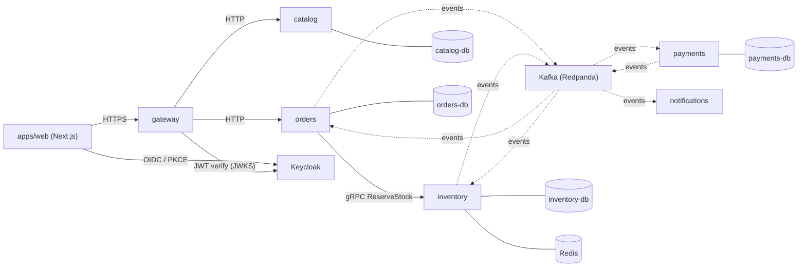
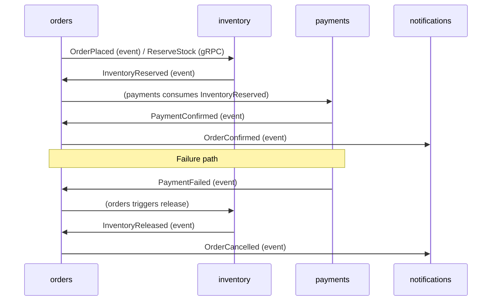

# Architecture

## Services

Each service owns its own Postgres database; there is no shared database and no service imports
another service's code. Cross-service contracts live in `contracts/` and are generated into each
consuming service.

## Saga flow

See `docs/event-catalog.md` for the full topic/producer/consumer table and `docs/decisions/` for the
reasoning behind the major architectural choices.
